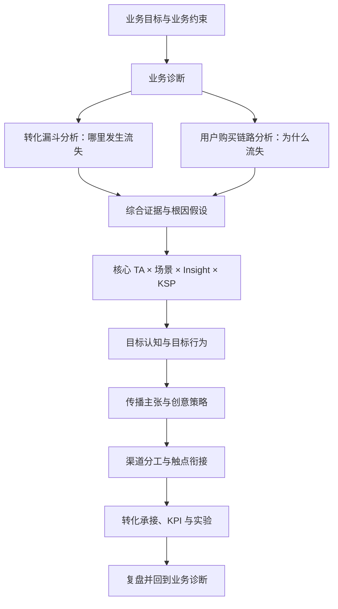
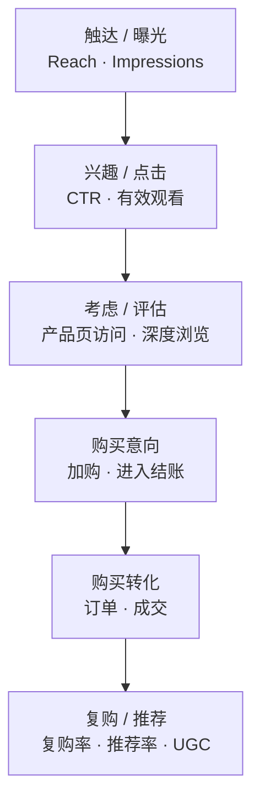
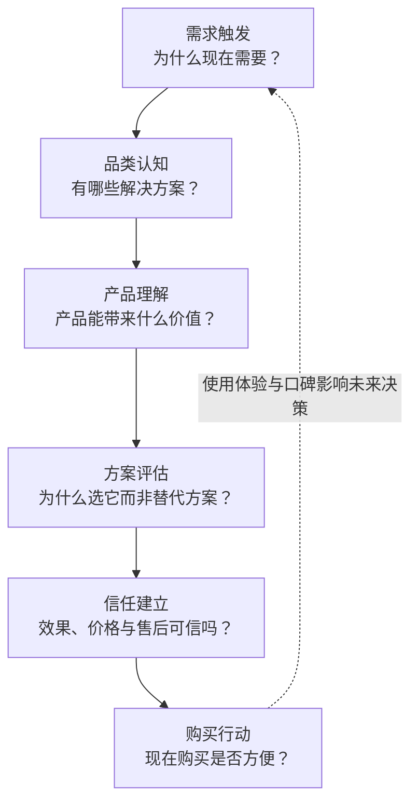
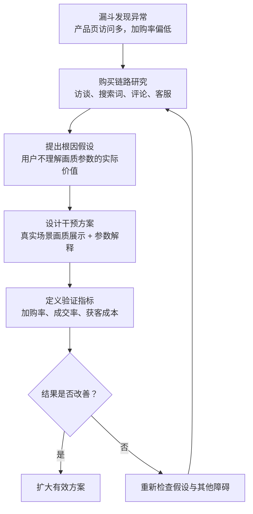
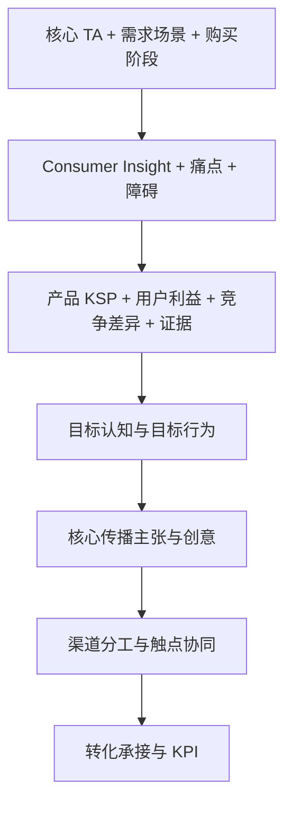

# IMC 整合营销策略制定方法论 v1.0

> 版本：1.0  
> 整理日期：2026-10-23  
> 用途：作为整合营销策略、增长诊断、营销方案设计与项目复盘的可复用工作框架。  
> 说明：本文中的激光投影仪案例与数据均为方法演示，非真实业务数据或行业基准。

---

## 一、核心原则：先诊断，再制定方案

整合营销不是先决定做什么创意、找哪些 KOL 或投什么广告，而是先明确业务目标与增长障碍，再通过用户证据解释问题，最后设计能够改变认知或行为的传播与转化方案。

推荐把工作拆为三个层次：

1. **业务诊断：** 业务目标是什么？增长卡在哪里？
2. **策略制定：** 哪类用户在什么场景下，因为什么需求或障碍，需要我们传递什么价值？
3. **IMC 方案与验证：** 如何通过创意、渠道协同和转化承接推动行为改变，并验证业务效果？

**重要边界：** 业务问题不一定都是传播问题。价格、库存、产品竞争力、渠道覆盖、支付体验、销售能力或售后政策也可能影响结果。IMC 可以解决其中一部分问题，并与产品、销售、电商、客服等团队协同处理其他问题。

---

## 二、分析线 A：转化漏斗——定位问题发生在哪里

转化漏斗关注可观测的行为和结果，核心问题是：**用户在哪个环节流失？流失规模有多大？**

### 2.1 每一层应该看什么

| 环节 | 可观察指标示例 | 常见诊断方向 |
|---|---|---|
| 触达 | 目标 TA 触达、展示量、有效频次 | 覆盖是否充分、受众是否精准、频次是否过高 |
| 兴趣 | CTR、有效观看、互动、品牌搜索 | 创意吸引力、信息相关性、受众与内容匹配度 |
| 考虑 | 产品页访问、停留、关键模块浏览、站内搜索 | 产品信息是否清晰、流量意图是否匹配 |
| 意向 | 加购率、收藏、咨询、进入结账 | 购买理由、价值感、价格与竞品比较、信任障碍 |
| 成交 | 结账转化率、CVR、订单量、CAC | 运费、支付、库存、优惠、交付与售后政策 |
| 长期价值 | 复购率、推荐率、退货率、UGC | 产品体验、服务体验、用户运营与口碑 |

### 2.2 演示数据：激光投影仪 DTC 漏斗

以下仅为假设数据，用于说明分析方法，不是行业基准。

| 环节 | 用户数 | 环节转化率 |
|---|---:|---:|
| 落地页访问 | 100,000 | — |
| 产品详情页访问 | 30,000 | 30% |
| 加购 | 3,000 | 10% |
| 进入结账 | 1,500 | 50% |
| 成交 | 900 | 60% |

如果历史数据、渠道对照或同类人群数据显示“产品详情页到加购”的 10% 明显异常，那么应优先诊断这一环节，而不是直接增加曝光预算。

但不能仅凭单个转化率判断问题。还应比较：
- 历史趋势与合理基准；
- 不同渠道、受众、国家/地区、设备和落地页；
- 流量意图与样本量；
- 价格、促销、库存、物流、支付和售后政策的变化。

### 2.3 常见漏斗症状与假设

- **曝光高、点击低：** 可能是 TA 不精准、创意吸引力不足、传播信息与需求不匹配。
- **点击高、加购低：** 可能是用户感兴趣，但没有看到足够的购买理由；也可能是价格、规格、页面体验或流量质量问题。
- **加购高、成交低：** 可能是运费、结账流程、支付方式、库存或信任问题。
- **成交尚可、退货或推荐表现差：** 可能涉及预期管理、产品体验、售后服务或用户运营。

**结论：漏斗用于定位异常环节，但不能独立证明根因。**

---

## 三、分析线 B：用户购买链路——解释用户为什么流失

购买链路还原消费者的决策过程：需求如何产生、如何认识解决方案、如何比较、担心什么、什么证据能推动购买。

### 3.1 以激光投影仪为例

| 决策阶段 | 用户可能在想什么 | 潜在障碍 | 需要验证的证据 |
|---|---|---|---|
| 需求触发 | 我为什么需要升级观影体验？ | 现有电视够用、没有明确升级需求 | 访谈、搜索趋势、用户场景研究 |
| 品类认知 | 投影仪和大屏电视有什么区别？ | 不理解激光投影的价值 | 品类搜索词、评论、客服问题 |
| 产品理解 | 4K、亮度、对比度对我有什么实际影响？ | 参数难理解、缺少真实体验 | 用户测试、内容反馈、产品页行为 |
| 方案评估 | 它值得这个价格吗？ | 竞品更便宜、价值感不足 | 竞品比较、价格研究、流失访谈 |
| 信任建立 | 实际效果会不会和宣传不同？ | 担心环境适配、安装、退换和售后 | 评测、评论、售后咨询、退货原因 |
| 购买行动 | 我现在能放心下单吗？ | 支付摩擦、缺货、优惠或物流不清晰 | 结账数据、客服记录、弃单调查 |

### 3.2 购买链路的证据来源

- 用户访谈与可用性测试；
- 站内搜索词、广告搜索词与搜索趋势；
- 用户评价、差评、社交媒体讨论和竞品评测；
- 客服咨询、售前问题、退货原因与售后工单；
- 产品页浏览、加购、结账与流失行为；
- 零售体验、销售人员反馈与现场观察。

购买链路不是严格线性的。用户可能先看 KOL 视频，再去搜索引擎找评测、问朋友、浏览产品页，之后在线下体验，最后才购买。IMC 的任务之一，是让这些触点相互衔接，而不是每个渠道各讲各的。

**关键区别：**
- 转化漏斗看可观测的行为和结果：用户有没有点击、加购、购买。
- 用户购买链路看行为背后的动机和障碍：用户为什么点击、为什么犹豫、为什么放弃。

---

## 四、如何结合两条分析线：从异常到可验证的根因

### 演示案例

1. **漏斗发现异常：** 产品页访问量高，但加购率偏低。
2. **购买链路寻找原因：** 用户研究发现，部分用户不理解高亮度、高分辨率与实际观影体验的关系。
3. **提出可验证假设：** 如果通过真实家庭场景展示画质差异，并解释技术参数如何影响体验，加购率可能提高。
4. **设计测试：** 对比现有页面与新页面，尽量控制流量来源、价格、促销等其他变量。
5. **评估结果：** 查看加购率、成交率、获客成本及后续退货情况，而不是只看点击率。

要注意：相关性不等于因果性。投放后销量上涨，不代表全部增长由该方案带来。条件允许时，可使用 A/B 测试、地域测试、对照组或其他增量测量方法。

---

## 五、从诊断进入策略：升级后的 IMC 核心框架

仅使用“TA + 使用场景 + 产品 KSP”还不够。中间需要 Consumer Insight、竞争替代方案和行为改变目标。

### 5.1 核心策略公式

1. **WHO：为谁解决问题**  
   核心 TA + 需求场景 + 所处购买阶段。
2. **WHY：为什么他会在意**  
   Consumer Insight + 现有痛点 + 决策障碍。
3. **WHAT：我们凭什么胜出**  
   产品 KSP + 用户利益 + 竞争差异 + 可信证据。
4. **CHANGE：我们要改变什么**  
   目标认知 → 目标行为 → 业务结果。
5. **HOW：如何实现改变**  
   核心传播主张 + 创意表达 + 渠道分工 + 转化承接。

### 5.2 为什么不能从 TA 直接跳到 KSP

“35 岁以上男性”是人口统计标签，不代表这个群体都重视画质，也不代表他们都喜欢家庭观影。需要继续验证：
- 他是画质发烧友、家庭娱乐决策者，还是想用大屏替代电视？
- 他最重视画质、沉浸感、易用性、价格，还是安装与售后？
- 他在什么场景下产生需求？
- 现有解决方案是什么？为什么还不满足？
- 哪个产品优势能真正改变他的选择？

---

## 六、实战案例：35–50 岁男性 × 家庭观影 × 激光投影仪高清卖点

> 本案例是策略演练。TA、洞察、产品规格与传播主张都需要通过真实研究和产品证据验证。

### Step 1：定义初始 TA 与场景

- **初始 TA 假设：** 35–50 岁男性，有一定可支配收入，对家庭影音设备感兴趣。
- **核心场景：** 晚上在家看电影、周末和家人观影、在客厅打造家庭影院。
- **待验证问题：** 他是画质发烧友、家庭娱乐决策者，还是想用更大的画面替代电视？三类用户的购买理由可能不同。

### Step 2：建立 Consumer Insight 假设

- 表面需求：想要一台画质足够好的投影仪。
- 可能的真实顾虑：参数看起来都很好，但不知道实际画面差异；花更多钱是否真的能改善观影体验？
- 待验证洞察：**“我不想只为一堆技术参数买单，我想确定它真的能让我在家获得接近影院的观影体验，而且值得这个价格。”**

洞察需要用户访谈、评论分析或测试来验证，不能把营销人员的合理猜测当作既定事实。

### Step 3：把 KSP 翻译成消费者利益

| 产品 KSP（假设） | 消费者利益 | 所需证据 |
|---|---|---|
| 4K 原生分辨率 | 大屏观看时画面细节依然清晰 | 真实素材、细节展示、准确规格说明 |
| 激光光源 | 根据具体技术实现，可能带来亮度、色彩或光源寿命方面优势 | 亮度测量、色彩表现、寿命与测试条件 |
| 高对比度 | 明暗层次更清楚，暗场细节更容易辨认 | 同场景、同条件下的对比展示 |
| 大尺寸投影 | 在家获得更沉浸的观影体验 | 真实房间布置、画面尺寸与推荐观看距离 |

4K、激光和大屏不是同一维度的卖点：4K 描述分辨率，激光描述光源技术，大屏描述画面尺寸。不要把它们机械地平级堆在一条广告里。实际主推卖点应由产品规格、竞品、价格定位和证据决定。

### Step 4：形成传播主张与创意方向

**方向 A：让细节自己说话**
- 主张：不只是看见画面，而是看见画面里的每一个细节。
- 创意：用电影中的纹理、暗场、自然景观等真实画面展示细节表现，并说明测试条件。
- 验证问题：高清是否是核心 TA 的主要购买动机？

**方向 B：把影院搬回家**
- 主张：不必出门，也能拥有属于自己的大银幕时刻。
- 创意：展示客厅从日常空间切换为家庭影院的过程，突出沉浸感与家庭共享。
- 验证问题：购买驱动力是否其实是家庭娱乐，而非单纯画质参数？

**方向 C：花得明白，买得放心**
- 主张：好画质，不只看参数，更要看真实表现。
- 创意：专业评测、真实家庭测试、技术解释和售后信息，降低决策风险。
- 验证问题：用户是否认可高清价值，却因价格或效果不确定而迟迟不买？

不一定要同时开展三个大型 campaign。可以根据研究选择一个主方向，再用其他内容支撑不同购买阶段。

### Step 5：让渠道各司其职、彼此衔接

| 渠道/触点 | 核心任务 | 内容方向 |
|---|---|---|
| YouTube / 专业评测 | 解释技术、验证画质、建立可信度 | 深度测试、真实场景、竞品比较 |
| 短视频 / 社交媒体 | 快速吸引注意力、激发兴趣 | 视觉细节、观影场景、简明解释 |
| 搜索 / 产品详情页 | 承接主动需求、帮助评估 | 规格、适用环境、价值比较、FAQ |
| 零售体验 / 线下 Demo | 降低效果不确定性 | 真实画质体验、现场答疑 |
| CRM / 再营销 / 售后内容 | 解决剩余疑虑、推动购买 | 安装、使用、退换、售后与优惠信息 |

IMC 不等于“每个渠道都投一点”，而是让渠道承担不同的说服任务，并保持核心信息一致。例如用户看完 YouTube 评测后访问产品页，应该能看到与评测一致的核心卖点和证据；如果用户因为安装问题离开，后续内容就应该回答安装问题，而不是重复播放画质广告。

---

## 七、KPI 设计：从传播输出到业务结果

| 目标层级 | KPI 示例 | 关键问题 |
|---|---|---|
| 传播触达 | 目标 TA 触达、有效观看、频次 | 是否触达正确的人？ |
| 认知改变 | 品类认知、核心卖点认知、广告回忆 | 用户是否理解差异？ |
| 考虑与意向 | 品牌搜索、产品页访问、购买意向 | 用户是否开始认真考虑？ |
| 转化表现 | 加购率、CVR、CAC、增量订单 | 是否推动实际购买？ |
| 长期价值 | 退货率、推荐率、口碑、复购 | 用户是否获得预期体验？ |

原则：
- 不是每个项目都要覆盖全部指标，应按目标和购买周期选取。
- 预先定义基线、目标值、测量窗口、数据来源和负责人。
- 区分曝光、播放等输出指标与认知、转化等结果指标。
- 不能仅凭投放前后变化认定因果关系；条件允许时使用对照组或增量测试。
- 关注退货与体验指标，避免用短期转化掩盖长期体验问题。

---

## 八、可复用的 IMC 工作流与交付物

### 8.1 六阶段工作流

| 阶段 | 核心任务 | 主要交付物 |
|---|---|---|
| 01 业务目标与基线 | 明确销量、市场份额、品牌认知或新品渗透目标及业务约束 | Business Brief |
| 02 漏斗诊断 | 按渠道、人群、地区、阶段拆分数据，识别异常环节 | Funnel Diagnosis |
| 03 用户决策研究 | 研究需求、场景、购买标准、竞品与决策障碍 | Customer Journey & Insight |
| 04 策略定义 | 确定 TA、Insight、价值主张、KSP、差异化和行为目标 | Strategic Brief |
| 05 创意与渠道整合 | 定义主张、内容支柱、渠道任务、触点衔接与转化承接 | IMC Plan |
| 06 执行与复盘 | 明确 KPI、预算、负责人、时间表、实验设计和优化机制 | Measurement Plan |

### 8.2 项目启动检查清单

- [ ] 业务目标、时间范围和业务约束是否明确？
- [ ] 是否有基线数据与可比较的历史/渠道/人群表现？
- [ ] 是否定位到具体异常环节，而不是只描述总体表现不佳？
- [ ] 是否用用户证据验证了根因，而不是仅凭经验猜测？
- [ ] TA 是否足够具体，且基于需求与行为，而非只有人口统计标签？
- [ ] 是否定义了真实场景、Consumer Insight 与购买障碍？
- [ ] KSP 是否转化成用户利益，并有可信证据支撑？
- [ ] 是否考虑竞品、替代方案和“不购买”的选择？
- [ ] 是否明确需要改变的认知、行为与业务结果？
- [ ] 核心主张是否统一，各渠道是否有明确分工？
- [ ] 产品页、零售、客服、售后等转化承接是否准备好？
- [ ] KPI、预算、负责人、测量窗口与实验方式是否明确？
- [ ] 是否有复盘机制，并允许根据结果回到根因假设重新诊断？

---

## 九、可直接复用的策略 Brief 模板

### 1. Business Context
- 业务目标：
- 当前基线：
- 目标值与时间范围：
- 预算与资源约束：
- 非营销业务因素：

### 2. Funnel Diagnosis
- 异常环节：
- 数据证据：
- 与历史/渠道/人群基准的差异：
- 潜在损失规模：
- 尚未确定的原因：

### 3. Customer Journey
- 需求触发场景：
- 用户当前解决方案：
- 购买决策标准：
- 最大疑虑/障碍：
- 证据来源：
- 关键洞察及置信度：

### 4. Target Audience
- 核心 TA：
- 次要 TA：
- 需求场景：
- 购买阶段：
- 不优先覆盖的人群及原因：

### 5. Value Proposition
- Consumer Insight：
- 核心 KSP：
- 用户利益：
- 竞争差异：
- 支撑证据：
- 不能夸大或尚未验证的主张：

### 6. Communication Strategy
- 目标认知：
- 目标行为：
- 核心传播主张：
- 内容支柱：
- 创意方向：
- 渠道分工与触点衔接：

### 7. Conversion & Measurement
- 转化承接：
- KPI 与基线：
- 目标值：
- 数据来源：
- 实验/对照设计：
- 预算与负责人：
- 复盘时间与决策标准：

---

## 十、方法论总结

整套逻辑可以浓缩为一句话：

**用转化漏斗找到业务损失，用用户购买链路解释损失原因，再用 TA、场景、洞察、产品价值和竞争差异制定传播策略，最后通过渠道协同与可验证的 KPI 推动业务增长。**

最重要的原则是：不要从 TA 直接跳到 KSP。先用数据定位问题，再用消费者证据解释问题，最后决定传播需要改变什么。

这套方法既要有品牌与创意的高度，也要有增长策略的可执行性。
